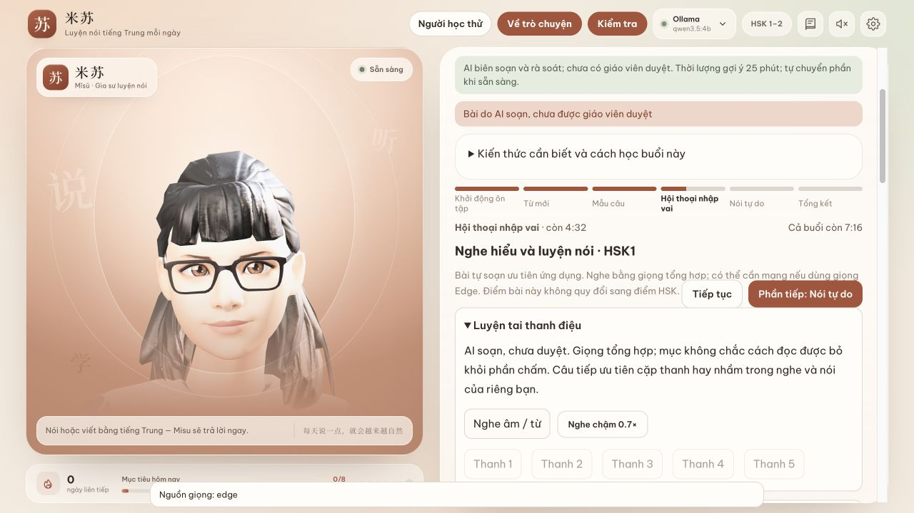

# 米苏 · Misu — private Chinese listening and speaking practice for Vietnamese learners

Misu is a private listening and speaking app for Vietnamese learners of Chinese: listen
before seeing characters, speak with an avatar, review pronunciation, and revisit the
errors you actually make. It runs on your machine and is not meant to replace a complete
course.

*Private* depends on configuration: Whisper and Ollama/LM Studio run locally; Edge
voices need a network; model APIs and browser speech recognition are optional and send
data to those services.



*Real app, sample 3D avatar and a test learner in temporary data; not a real learner.
AI-authored content has not been reviewed by a teacher.*

## What is included

An additional **30 communication lessons for HSK1–6** (240 words, 90 patterns)
are available through the explicit study-path option. The existing HSK1/HSK5
defaults stay unchanged. Entering volume 2/3 shows a notice and a way to start
at lesson 1. All new material remains AI-authored, not teacher-reviewed.

Lesson-linked listening contains **198 dictation sentences + 48 shadowing
passages (246 unique IDs)** for the original 48 sessions, separate from the
global banks. Pinyin and declared tone variants are preserved.

- **48 fixed sessions**, 12 topics × 2 sessions for each of HSK 1 and HSK 5, plus **4
  self-authored checkpoint tests**. Open **Today → Study path**. HSK 1 takes about 25
  minutes per session, HSK 5 about 30.
- Fixed content needs no model; interactive role-play does. Role-play includes listening,
  choosing an answer, opening the transcript/explanation, then repeat/retell and answer.
- Content is **AI-authored and AI-checked, not reviewed by a teacher**. Misu does not
  claim full HSK coverage or convert mini-test scores into exam scores. HSK 1 speaking is
  a communication extension, not the official speaking test.
- **Checks**: a weekly test is due after 7 days or 3 new lessons, a monthly test after 30
  days. Tasks come from each learner's words, errors and lessons; with little data the
  test is shorter. AI and tone scores are estimates, not an HSK certificate. Unscorable
  parts are not counted; different tests are not fully equivalent.

## Listening and speaking features

- **Tone listening**: hear syllables or two-syllable words and choose the tone, using
  pairs learners commonly confuse; sandhi checked via `acceptTones`.
- **Similar sounds**: zh/z, ch/c, sh/s, j/q/x, ü/u and n/ng finals; scored by ear, no STT.
- **Dictation**: Hanzi or pinyin, replay chunk by chunk, mark differences; includes
  DeepSeek sentences and lesson examples.
- **Three speeds 0.7/0.85/1×** plus slow play; role-play hides text by default.
- **Optional Common Voice**: 154 Beijing Chinese sentences selected by AI, with estimated
  level and Vietnamese meaning; audio is read from a folder you download, not shipped in
  the repo, not shared to LAN devices.
- **Shadowing**: model then your recording, two pitch tracks, length and pauses; similar
  contours are not a pronunciation certificate.
- **Pronunciation review**: character → word → sentence, two clear matches in a row;
  unscorable characters are not counted; long sentences are not auto-confirmed; tone/sound
  errors get a shorter review schedule than vocabulary.
- **Last utterance**: at most 5 local recordings, 20 MB total, in session RAM; reloading loses them.
- **Fluency**: weekly trend, estimated syllables/second, pauses, separated STT/model/TTS/
  speaking time; the 2.5-second target is not confirmed.
- **Han-Viet**: per-character Unihan `kVietnamese` reading with source/variants/missing
  data; not a context-sensitive standard reading. DeepSeek notes split into **Meaning
  traps / Sound tips**, AI-authored, not reviewed.
- **Conversation and correction** with local models or an optional API; sample
  TalkingHead/LAM avatar; multiple learner profiles with local storage and backup.

DeepSeek sets keep the **"AI-authored, not reviewed"** label. They are practice
materials, not official HSK tests or evidence of learning effectiveness.

## Before choosing an app

Criteria to check, not claims about every product in a category; no unverified competitor
numbers.

| Category | What to compare | Misu today / limits |
|---|---|---|
| Course apps | Editorial quality, path, mobile experience | 48 HSK1/HSK5 practice sessions; no teacher review, no native mobile app |
| Online AI tutors | Convenience, feedback quality, data sent | Local models or your own API; setup required; small models can still be wrong |
| Pronunciation apps | Phoneme feedback, reliability on learner voices | Estimated tone scoring for 1–2 characters; long sentences mostly pitch display; not validated on real Vietnamese learners |
| Dictionaries / SRS | Vocabulary coverage, context readings, review schedule | Separate word/error review; Unihan lacks some characters and heteronyms, not a replacement for a specialized Han-Viet dictionary |

Misu has no writing practice. Real voices are possible only through optional Common
Voice; audio is not shipped with the repo and voice coverage remains limited.

## Install

Requires **Node.js 24** and npm. Tested on macOS Apple Silicon; Windows/Linux paths and
three-OS CI were added, but **not tested on real Windows**. Fixed lessons need no
Ollama/GPU. Chat and correction need Ollama/LM Studio or an API configured in Settings.
ffmpeg is required for Whisper/tone scoring: `brew install ffmpeg` on Mac,
`winget install --id Gyan.FFmpeg --exact` on Windows. Edge voices need a network; browser
voices are a fallback if the right language is installed.

```bash
git clone https://github.com/hydennguyen86-code/xiaoya-chinese-tutor.git
cd xiaoya-chinese-tutor && npm ci
ollama pull qwen3.5:4b
```

Low-RAM machines can use fixed lessons or an optional API. **System check** reads server
RAM as a hint only; RAM does not guarantee CPU/GPU speed. The launchers
(**start-mac.command**, **start-windows.bat**) check Node, run `npm ci` when needed,
build, check Ollama and open the browser on the local machine. If macOS blocks a
downloaded file, use the terminal commands and do not disable OS protections.

Optional local speech recognition (git and cmake; about **466 MB**):

```bash
npm run setup:whisper            # macOS/Linux
npm run setup:whisper:windows    # Windows x64, PowerShell
```

The script pins whisper.cpp **v1.7.6** and verifies SHA256 for the ZIP/model. Downloads
go to gitignored `vendor/` and `models/`. A smaller model can be selected with
`-Size base` then `WHISPER_MODEL`. Windows ARM64 and a real Windows install are **not
verified**.

```bash
npm run build && npm start       # http://127.0.0.1:8787
npm run dev                      # Vite on port 5173
```

Without whisper.cpp, the microphone uses browser speech recognition (Chrome sends audio
to Google) and tone scoring is unavailable.

| Variable | Default | Meaning |
|---|---|---|
| `PORT`, `HOST` | `8787`, `127.0.0.1` | server address |
| `XIAOYA_DATA_DIR` | `./data` | learner data |
| `XIAOYA_SAMPLE_AVATARS` | off | `1` = sample avatar only, for tests/demos |
| `OLLAMA_URL`, `LMSTUDIO_URL` | default ports | model servers |
| `WHISPER_BIN`, `WHISPER_MODEL`, `WHISPER_PORT` | `vendor/…`, `models/ggml-small.bin`, `8178` | whisper.cpp |
| `VOICE_CLONE_URL`, `VOICE_CLONE_VI_URL` | ports `8766`, `8767` | optional self-hosted cloned voices |
| `FFMPEG_PATH`, `FFPROBE_PATH` | common dirs or PATH | audio tools |

**Your own avatar**: a `.glb` with ARKit blendshapes + visemes at
`data/avatars/personal.glb`, or a LAM `.zip` at `data/avatars/personal-lam.zip` built
from a photo with [LAM](https://github.com/aigc3d/LAM); or choose it in Settings.
`personal*` files are gitignored. Only use images of people who consented.

**Book syllabus**: the repo contains no book content. Type the table of contents into
`data/syllabus/tiyan-hanyu-kouyu.json` following
[docs/syllabus.example.json](docs/syllabus.example.json). Without it, the two fixed
HSK 1/HSK 5 paths are used. A custom syllabus with no fixed lessons is written by the
local model; the app does not modify an existing custom syllabus.

## Accuracy: what is measured

Benchmarks are in `eval/` and rerunable; raw results in [eval/results/](eval/results/).
Correction counts are in the
[qwen3.5:4b result](eval/results/corrections-qwen3.5_4b-2026-10-24.json). The
[three-level lesson generation run](eval/results/lessons-qwen3.5_4b-2026-10-24.json)
confirms response shape only, not content.

**Old correction pipeline, 24 Oct 2026** (`npm run eval:corrections`, qwen3.5:4b, old
40-sentence set): **0/22** correct sentences were wrongly changed; **17/18** wrong
sentences were detected and **16/18** fixed exactly. The set is small and matches the
rule types, so other errors (word choice, rare grammar) are still decided by the 4B
model and are sometimes wrong. Other models must be measured separately on the same set.

**Historical fixed-rule measurement, no LLM**: the merged DeepSeek set plus similar correct sentences has **108
correct / 98 wrong**. Final rules changed **0/108** correct sentences and fixed **29/98**
wrong ones; **69** errors were not caught.
[Per-rule audit and source hash](eval/results/grammar-rules-deepseek-merged-2026-10-25T05-24-46-248Z.json).
Rerun with `node eval/rule-corrections.mjs`. AI test labels are **not expert-reviewed**,
and 0 wrong changes outside this set is not guaranteed. `eval/corrections.json` is larger
than the old set; the LLM pipeline has **not been re-measured on it**.

**Tones**: latest comparable recording is
[Tingting, 24 Oct 2026](eval/results/tones-macOS_Tingting-2026-10-24.json), commit
`841d68b`; the working tree still had changes when measured. It is a macOS synthetic
voice and thresholds were tuned on Tingting, so this is not independent validation.

| Voice with result file | Characters read alone | Characters inside two-character words |
|---|---|---|
| Tingting | 35/40 correct, 0 unscored | 25/29 scorable characters correct; 3/32 unscored |

Flo/Reed/Grandpa/Shelley numbers were removed because no result files are in the repo.
The TTS set has not been rerun after UI/syllable-mark changes; `classifyIsolated`
thresholds are unchanged.

This is a synthetic reference voice, not a learner: accuracy on human voices (especially
beginners, hesitant speech) has **not been measured**. Misu therefore scores individual
characters only for 1–2 characters; for long sentences it draws pitch tracks and reports
**"unscored"** instead of guessing. Isolated tone 1 and tone 3 differ mainly in pitch
height, so the app needs a few sentences to learn your vocal range.

## Privacy

- Ollama/LM Studio answers and corrections, Whisper and tone scoring run locally. The
  server listens on `127.0.0.1` by default; LAN is opt-in.
- Optional APIs receive the transcript, conversation and related learning data at the
  URL you agreed to. The model API does not receive raw audio. The service may charge.
- **Edge voices** (default) send response *text* to Microsoft. On failure Mac tries
  `say`, then browser `speechSynthesis` if a matching voice exists. Some browser voices
  use the network; the app shows the voice source and does not promise all are offline.
- **Browser speech recognition** (only without whisper.cpp) sends audio to the browser
  vendor.
- Learner data lives in gitignored `data/`.

## Real-voice recordings

In **Check → Record personal voice benchmark**, read 40 characters and 16 words, listen
back, enter the labeler's name and choose self-assessment or a good listener. Label the
tone **actually heard** per character; `0` means unclear. Re-recording clears that item's
old labels. Files go to `$XIAOYA_DATA_DIR/eval-recordings/<learner>/`.

```sh
npm run eval:tones -- --recordings=data/eval-recordings/<learner>
```

Runs locally and needs ffmpeg; no Ollama or network. `eval/results/` gets aggregate
numbers only, with no audio, labeler names or profile paths. The matrix separates self
from other listeners; the voice range comes from the same recordings, so it is not
independent validation. **No labeled real-voice set exists yet. Tone thresholds have not
been adjusted. There are no before/after numbers; the TTS numbers remain the reference.**

```sh
bash scripts/smoke-test.sh
SMOKE_REQUIRE_TTS=1 bash scripts/smoke-test.sh
```

The smoke test clones the committed version to a temp folder, runs `npm ci`, builds and
runs with the sample avatar and temporary data on port 8791, checks status, syllabus,
avatars and TTS, then cleans up. A **second macOS machine has not been tried**; the
checklist in `docs/IMPLEMENTED-next-2.md` is a test plan, not a success report.
`npm run test:edge:live` uses the network, requires `provider=edge`, rejects a Mac voice
fallback, and is separate from `npm test`/CI. GEC v2 replaces the v1 URL/token of
`msedge-tts` 2.1.0 following [upstream Edge TTS issue 490](https://github.com/rany2/edge-tts/issues/490).

## API for weak machines

**Settings → Weak machine · use your API** takes a Chat Completions URL (including
`/v1`), model id and key; the endpoint must support JSON-object responses. Tick data
consent, then save; changing the URL requires consent again. Responses are read fully
before display, so tokens may not appear immediately. **No external API model has been
measured in this repo or is recommended for quality.**

The key is stored in `$XIAOYA_DATA_DIR/private/provider.json`, outside browser-synced
data. It is never returned, and upstream errors are not echoed verbatim. Configuration
and deletion work only from the server's localhost; LAN devices with a PIN cannot
configure it. The file relies on OS permissions, not a separate encrypted vault. Keep the
data directory out of Git and delete with **Clear API/key**. Measuring a configured model
may cost money and should only be recorded when a result file exists:

```sh
EVAL_PROVIDER=compatible npm run eval:corrections -- CONFIGURED_MODEL_ID http://127.0.0.1:8791
```

## Phone on the same Wi-Fi: HTTPS + PIN

Default remains localhost. LAN mode is only for trusted devices. A PIN device can read
and edit **all** shared learner data; this is not a separate account system.

```sh
HOST=0.0.0.0 PORT=8791 XIAOYA_DATA_DIR=/tmp/misu-lan-test XIAOYA_SAMPLE_AVATARS=1 npm start
```

- HTTPS uses a self-signed certificate; certificate and private key are in the data
  directory's `private/`. Share only the public certificate, never `lan-key.pem`.
- Settings shows the IP, a QR **without the PIN**, the PIN and the certificate
  fingerprint. Compare the fingerprint on the server; trust the certificate through
  device settings or a certificate already trusted for that IP. Do not disable TLS checks
  or click through warnings.
- If the platform does not trust the self-signed certificate for microphone/PWA, provide
  `XIAOYA_TLS_CERT` and `XIAOYA_TLS_KEY` with a valid pair and the Wi-Fi IP in SAN. HTTPS
  alone does not make a certificate trusted.
- Phone scans the QR and enters the PIN. Sessions use Secure/HttpOnly cookies for at most
  **12 hours** and are revoked on restart. **8** wrong attempts lock for **10 minutes**.
  `XIAOYA_LAN_PIN` accepts **6–10 digits**; a new random PIN is created each run by
  default.
- Allow the app through the firewall on private networks only; never expose the router
  port to the Internet. Recheck address/certificate after an IP change. Stop the server
  to end sharing.
- A PWA manifest exists; "Add to Home Screen" works if the browser meets the install
  criteria. The service worker does not cache APIs/audio/learner data; the server is
  still required.

UI was checked at **375px** and the HTTPS/PIN flow with a test client; microphone,
certificate trust and PWA install were **not verified on a real Android/iPhone**.
Simulated checks are not device checks.

## Avatars, builds and Common Voice

Personal avatars live in `data/avatars/` and are served with the same LAN/PIN
protection. Outside sample mode the server copies old `public/avatars/personal.glb` and
`personal-lam.zip` there if missing; it never deletes or overwrites your files.
`XIAOYA_SAMPLE_AVATARS=1` skips the copy. Builds copy only an allowlist and reject
unknown files in `dist`; **do not zip or upload the whole `dist` folder**, because
`mom*`/`personal*` files from earlier builds may remain. Rerun `npm run build` and do not
ship `data/avatars`.

Common Voice is optional: MP3s are read directly from `XIAOYA_COMMON_VOICE_DIR` outside
the repo, not copied into app data and not served to LAN. `npm run corpus:import`
supports `validated.tsv` and `train/dev/test.tsv`; see
[docs/COMMON-VOICE.md](docs/COMMON-VOICE.md). LAN PIN devices can also submit feedback
recordings; the PIN does not separate profiles. Replay recordings are limited to **5
takes** and **20 MB** total in RAM; saving labels is a separate action.

## License and contributing

Original app code is MIT ([LICENSE](LICENSE)); `server/edgeGec.mjs` is LGPLv3 and kept as
replaceable source. The sample avatar and libraries have their own licenses;
`brunette.glb` is **non-commercial use only**. See [NOTICE.md](NOTICE.md) and
[CONTRIBUTING.md](CONTRIBUTING.md). AI-authored, unreviewed lessons are in
[lessons/](lessons/).


## Updated correction and recording controls

The strict rule audit separates full-sentence matches from expected fragments:
0/112 correct sentences changed, 8/102 full-sentence matches, 26 partial matches.
These figures are not directly comparable to historical substring-based scores;
many benchmark targets are fragments. The LLM pipeline has not been rerun.
[Strict audit](eval/results/grammar-rules-deepseek-merged-2026-10-25T14-10-55-134Z.json).

Human labels use self/peer/expert roles chosen by the listener; these roles are
self-declared, not verified credentials. In Settings, a learner's recordings
and labels can be exported to a private ZIP or explicitly deleted. Recordings
are retained until deletion. ZIPs contain voices and reviewer names; export
only when you intend to keep or share them yourself. No human audio is shipped
in this repository. Threshold tuning still requires a fully labeled 56-item set.
