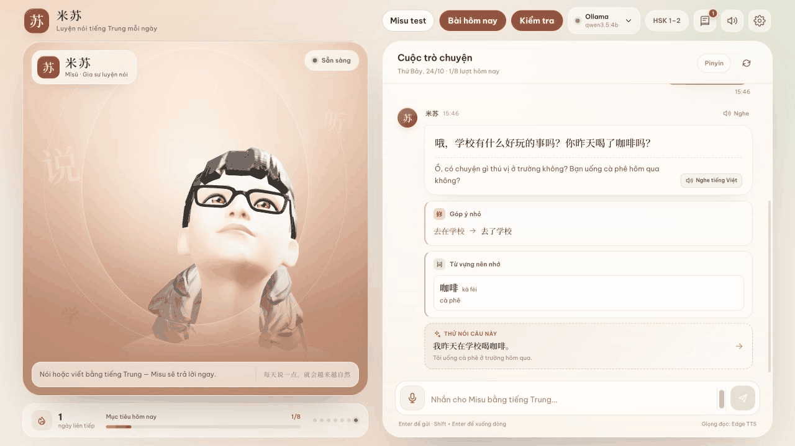

# 米苏 · Misu — luyện nói tiếng Trung với avatar 3D, chạy trên máy của bạn

*A Chinese speaking tutor for Vietnamese learners: a 3D avatar you talk to, a
local LLM that replies at your HSK level and corrects your sentences, local
speech-to-text, tone checking, and a daily guided lesson. Everything except
the optional online voices runs on your own computer. The interface is in
Vietnamese.*

Misu là bạn luyện nói tiếng Trung cho người Việt: bạn nói (hoặc gõ), avatar trả
lời bằng tiếng Trung có pinyin và bản dịch tiếng Việt, sửa câu sai, ghi lại từ
mới để ôn, và mỗi ngày có sẵn một bài học theo lộ trình để khỏi phải tự chọn học gì.



*Demo thao tác bằng bàn phím (30 giây, dữ liệu giả lập, avatar hoạt hình mẫu).
Chưa phải bản quay luyện nói bằng micro.*

## Học ngay: HSK 1 và HSK 5 ứng dụng

Có sẵn **48 buổi cố định**, 12 chủ đề × 2 buổi cho mỗi lộ trình, kèm **4 bài
kiểm tra chặng** tự soạn. Mở **Bài hôm nay → Lộ trình học**, chọn HSK 1 hoặc
HSK 5. Trong phần Hội thoại nhập vai có bài nghe, chọn đáp án rồi mở bản chép
lời/giải thích; tiếp theo là nhắc lại/kể lại, đọc và trả lời theo nhiệm vụ.
Nội dung cố định không cần model soạn lại; nhập vai tương tác vẫn cần model.

- [Tài liệu HSK 1 thực tế](lessons/courses/HSK1-GUIDE.md): khoảng 25 phút/buổi.
- [Tài liệu HSK 5 thực tế](lessons/courses/HSK5-GUIDE.md): khoảng 30 phút/buổi.
- [Nguồn dạng thi và giới hạn](lessons/courses/EXAM-ALIGNMENT.md).

Đây là giai đoạn thực hành đầu tiên, AI biên soạn và rà soát, **chưa có giáo viên
duyệt**. Không tuyên bố bao phủ toàn bộ HSK hoặc quy đổi điểm mini thành điểm
thi. Phần nói HSK 1 là mở rộng giao tiếp, không gọi là phần thi nói chính thức.

## Kiểm tra và chuẩn bị

Lần mở đầu có màn hình kiểm tra model, ghi thử micro, nhận dạng local, nghe TTS
và hội thoại mẫu. Mở lại từ **Cài đặt → Kiểm tra hệ thống và micro**.

Nút **Kiểm tra** cạnh **Bài hôm nay** cho phép thi tuần/tháng và xem lịch sử.
Bài tuần đến hạn sau 7 ngày hoặc 3 buổi mới; bài tháng sau 30 ngày. Đề lấy từ
các từ, lỗi và bài đã học của từng người. Thiếu dữ liệu thì đề ngắn hơn.
Nhiệm vụ giao tiếp dùng bối cảnh mới; xin gợi ý được ghi riêng. Điểm AI và
thanh điệu chỉ là ước lượng, không phải chứng chỉ HSK. Phần không chấm được
không tính điểm; các lần có đề khác nhau không hoàn toàn tương đương.

## Tính năng

- **Avatar nói chuyện**: avatar 3D (TalkingHead, cử động môi theo tiếng nói)
  hoặc avatar LAM dựng từ ảnh thật (Gaussian splatting, chạy ngay trong trình
  duyệt).
- **Trả lời theo trình độ**: HSK 1–2 câu rất ngắn, chậm; HSK 5–6 nói tự nhiên,
  dài hơn. Mô hình chạy cục bộ qua Ollama hoặc LM Studio.
- **Sửa câu**: luật cố định cho các lỗi người Việt hay mắc (lượng từ, 比…很,
  没…了, trật tự trạng ngữ nơi chốn/thời gian, 一点儿) cộng với mô hình, có bộ
  lọc để không "sửa" những câu vốn đã đúng.
- **Nhận dạng giọng nói cục bộ** bằng whisper.cpp: giọng bạn không rời khỏi máy.
- **Chấm thanh điệu**: đọc một từ, Misu chỉ ra chữ nào sai thanh và cách sửa;
  đọc một câu, Misu vẽ đường cao độ của bạn cạnh giọng mẫu.
- **Bài hôm nay**: ôn từ và lỗi cũ của chính bạn → từ mới → mẫu câu →
  đóng vai → nói tự do → tổng kết. Mặc định dùng hai lộ trình Misu tự soạn; có thể dùng mục lục
  sách riêng (xem phần [Mục lục sách](#mục-lục-sách)).
- **Nhiều người học** trên một máy, mỗi người có trình độ, lịch sử và từ ôn
  riêng.
- **Dữ liệu nằm trong thư mục `data/`** (mỗi mục một file JSON, sao lưu mỗi ngày,
  giữ 14 ngày), không phụ thuộc bộ nhớ trình duyệt.

## Cài đặt

Cần: macOS trên Apple Silicon (đã thử), Node.js 24, [Ollama](https://ollama.com/)
và ffmpeg (`brew install ffmpeg`). Máy khác vẫn chạy được phần chính; giọng dự
phòng `say` và tăng tốc Metal chỉ có trên macOS.

```bash
git clone https://github.com/hydennguyen86-code/xiaoya-chinese-tutor.git
```

```bash
cd xiaoya-chinese-tutor && npm install
```

```bash
ollama pull qwen3.5:4b
```

Nhận dạng giọng nói cục bộ (không bắt buộc; cần git, cmake; tải về khoảng 466 MB):

```bash
npm run setup:whisper
```

Chạy:

```bash
npm run build && npm start
```

Mở <http://127.0.0.1:8787>. Khi phát triển dùng `npm run dev` (Vite ở cổng 5173).

Không có whisper.cpp thì micro dùng nhận dạng giọng nói của trình duyệt (Chrome
gửi âm thanh lên máy chủ Google) và không chấm được thanh điệu.

### Tuỳ chỉnh

| Biến môi trường | Mặc định | Ý nghĩa |
|---|---|---|
| `PORT`, `HOST` | `8787`, `127.0.0.1` | địa chỉ server |
| `XIAOYA_DATA_DIR` | `./data` | nơi lưu dữ liệu người học |
| `XIAOYA_SAMPLE_AVATARS` | tắt | đặt `1` để chỉ dùng avatar mẫu khi thử hoặc quay demo |
| `OLLAMA_URL`, `LMSTUDIO_URL` | cổng mặc định | máy chủ mô hình |
| `WHISPER_BIN`, `WHISPER_MODEL`, `WHISPER_PORT` | `vendor/…`, `models/ggml-small.bin`, `8178` | whisper.cpp |
| `FFMPEG_PATH`, `FFPROBE_PATH` | tự tìm trong thư mục cài phổ biến hoặc PATH | công cụ âm thanh |

### Avatar của riêng bạn

- Avatar 3D: đặt file `.glb` (Ready Player Me hoặc tương thích, có blendshape
  ARKit + viseme) ở `public/avatars/personal.glb`.
- Avatar LAM từ ảnh: dựng bằng [LAM](https://github.com/aigc3d/LAM) (bản demo
  online hoặc máy có GPU), rồi đặt file `.zip` ở `public/avatars/personal-lam.zip`.
- Hoặc chọn file ngay trong phần Cài đặt của ứng dụng.

Các file `personal*` đã nằm trong `.gitignore`, không bị đưa lên git. Chỉ dùng ảnh
của người đã đồng ý.

### Mục lục sách

Repo **không** chứa nội dung sách. Để lịch học đi theo đúng bài của
《体验汉语口语》, tự gõ mục lục (tên bài, số trang, chủ đề) vào
`data/syllabus/tiyan-hanyu-kouyu.json` theo mẫu [docs/syllabus.example.json](docs/syllabus.example.json).
Chưa có file này thì Misu dùng hai lộ trình HSK 1/HSK 5 cố định trong
`lessons/courses/`. Với mục lục riêng không có bài cố định, model cục bộ tự
soạn nội dung. App không thay đổi mục lục riêng đã có.

## Độ chính xác: đo được bao nhiêu

Cả hai bộ đo nằm trong `eval/` và chạy lại được trên máy bạn. Kết quả thô được lưu ở [eval/results/](eval/results/).

**Sửa câu** (`npm run eval:corrections`, qwen3.5:4b, 40 câu): 0/22 câu đúng bị
sửa nhầm; 17/18 câu sai được phát hiện, 16/18 sửa đúng như đáp án. Bộ câu nhỏ và
gồm đúng những loại lỗi mà luật đã viết cho, nên với lỗi khác (chọn từ, ngữ
pháp hiếm) phần sửa vẫn do mô hình 4B quyết định và có lúc sai. Mô hình khác cần được đo riêng bằng cùng bộ thử.

**Thanh điệu** (`npm run eval:tones -- --say="<giọng macOS>"`): đọc bằng giọng
tổng hợp của macOS thay cho người học. Ngưỡng được chỉnh trên giọng Tingting;
bốn giọng còn lại chưa từng dùng để chỉnh.

| Giọng | Chữ đọc riêng (40 chữ, 4 thanh) | Chữ trong từ 2 chữ |
|---|---|---|
| Tingting (dùng để chỉnh) | 35/40 | 25/29 đúng (3 chữ chưa chấm được) |
| Flo | 40/40 | 29/32 |
| Reed | 36/40 (1 chữ chưa chấm được) | 27/30 (2 chưa chấm được) |
| Grandpa | 31/40 (1 chưa chấm được) | 23/27 (5 chưa chấm được) |
| Shelley | 40/40 | 31/32 |

Lỗi còn lại chủ yếu là thanh 3 bị nghe thành thanh 2 và thanh 4 thành thanh 3,
nhất là giọng trầm (Grandpa).

Đây là giọng máy đọc chuẩn, chưa phải người học thật: con số với giọng người
(nhất là người mới học, đọc ngập ngừng) sẽ thấp hơn. Vì thế Misu chỉ chấm đúng/sai
từng chữ khi đọc từ 1–2 chữ, còn với câu dài thì chỉ vẽ đường cao độ để bạn tự
so, và báo "chưa chấm được" thay vì đoán khi không rõ. Thanh 1 và thanh 3 đọc
riêng chỉ khác nhau ở độ cao, nên Misu cần nghe bạn nói vài câu trước để biết
giọng bạn cao thấp thế nào.

## Quyền riêng tư

- Câu trả lời, sửa lỗi, nhận dạng giọng nói (khi có whisper.cpp) và chấm thanh
  điệu đều chạy trên máy bạn. Server chỉ nghe ở `127.0.0.1`.
- **Giọng đọc Edge** (mặc định) gửi *chữ* của câu trả lời lên dịch vụ của
  Microsoft để đọc. Không vào được thì tự chuyển sang giọng `say` của macOS.
- **Nhận dạng giọng nói của trình duyệt** (chỉ khi không có whisper.cpp) gửi âm
  thanh lên nhà cung cấp trình duyệt.
- Dữ liệu người học nằm trong `data/` (đã có trong `.gitignore`).

## Phát triển

```bash
npm run typecheck && npm test
```

- `src/`: React + Vite (giao diện, avatar, bài học).
- `server/`: Express (mô hình, giọng đọc, nhận dạng giọng nói, chấm thanh điệu,
  lưu dữ liệu).
- `eval/`: bộ đo sửa câu và thanh điệu.

## Giấy phép

Mã nguồn: MIT ([LICENSE](LICENSE)). Avatar mẫu và các thư viện có giấy phép
riêng, trong đó avatar `brunette.glb` chỉ dùng phi thương mại. Xem
[NOTICE.md](NOTICE.md).

## Đóng góp

Xem [CONTRIBUTING.md](CONTRIBUTING.md). Bài AI soạn chưa duyệt ở [lessons/](lessons/).

### Thu bộ đo giọng thật

Trong **Kiểm tra → Ghi bộ đo giọng cá nhân**, đọc 40 chữ và 16 từ, nghe lại,
điền tên người gắn nhãn và chọn tự đánh giá hoặc người giỏi nghe. Có thể gắn
thanh thực sự nghe được cho từng chữ; `0` nghĩa là không rõ. Ghi lại sẽ xoá
nhãn cũ của mục đó để tránh dùng nhãn cho nhầm audio. Bản ghi ở
`$XIAOYA_DATA_DIR/eval-recordings/<learner>/`, mặc định dưới `data/` đã được Git bỏ qua.

```sh
npm run eval:tones -- --recordings=data/eval-recordings/<learner>
```

Lệnh chạy trực tiếp trên máy, cần ffmpeg; không cần Ollama hay mạng.
`eval/results/` chỉ nhận số tổng hợp, không có audio, tên người gắn nhãn hoặc
đường dẫn hồ sơ. Ma trận so với nhãn người nghe, tách tự đánh giá/người nghe
khác; khoảng giọng được lấy từ cùng bộ ghi nên chưa phải kiểm định độc lập.
**Chưa có bộ giọng thật được gắn nhãn. Chưa chỉnh ngưỡng thanh điệu.**
Không có số trước/sau mới để báo cáo; các số TTS bên trên vẫn là mốc tham khảo.

### Kiểm tra bản cài sạch và máy macOS khác

```sh
bash scripts/smoke-test.sh
# Bắt buộc tạo được giọng đọc, nếu máy có đủ TTS:
SMOKE_REQUIRE_TTS=1 bash scripts/smoke-test.sh
```

Script clone bản **đã commit** vào thư mục tạm, `npm ci`, build, chạy bằng avatar
mẫu và dữ liệu tạm, kiểm tra status, mục lục, hai avatar và TTS rồi dọn sạch.
Mặc định dùng cổng 8791; dừng server thử cũ trước, hoặc đặt `SMOKE_PORT`.
Linux CI không cần Ollama. Nếu TTS không khả dụng, lượt thường xác nhận
phản hồi lỗi và báo rõ chưa xác minh tạo audio; lượt `SMOKE_REQUIRE_TTS=1` thất bại.

**Chưa thử trên máy macOS thứ hai.** Khi bạn có máy khác: cài Node 24 và Git,
clone repo, chạy script trên; sau đó `npm ci`, `npm run build`, chạy
`XIAOYA_SAMPLE_AVATARS=1 XIAOYA_DATA_DIR=/tmp/misu-test npm start`.
Mở app, tạo người học thử, vào HSK 1/HSK 5 và kiểm tra nghe; cài Whisper nếu
muốn thử thu âm/chấm thanh. Ghi lại phiên bản macOS, Node, CPU, lệnh chạy,
kết quả và lỗi vào `docs/IMPLEMENTED-next-2.md`. Đây là hướng dẫn cần thử,
không phải biên bản đã thử thành công.

- Thiếu **ffmpeg**: cài `brew install ffmpeg`, hoặc đặt `FFMPEG_PATH` và `FFPROBE_PATH` tới binary thật.
- Thiếu **cmake** khi cài Whisper: `brew install cmake`, rồi chạy lại `npm run setup:whisper`.
- **Ollama chưa chạy**: mở Ollama, tải model và kiểm tra `ollama list`; bài tự soạn vẫn mở được khi chưa có model.
- **Micro bị chặn**: cho phép micro trong quyền của trình duyệt và macOS; dùng localhost, kiểm tra thiết bị đầu vào. Không đổi ngưỡng để che lỗi thu âm.
