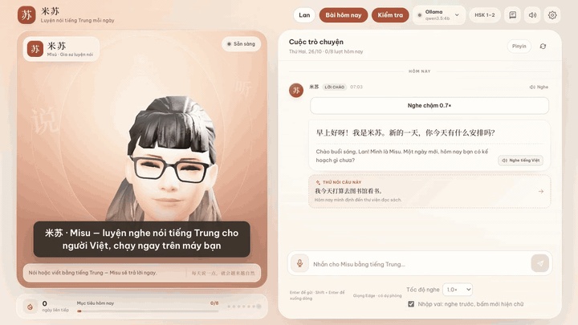
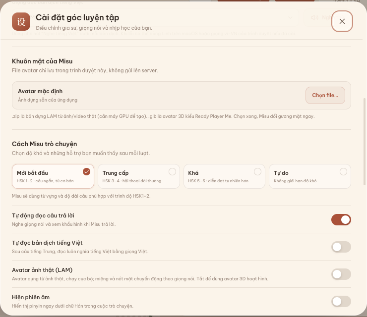
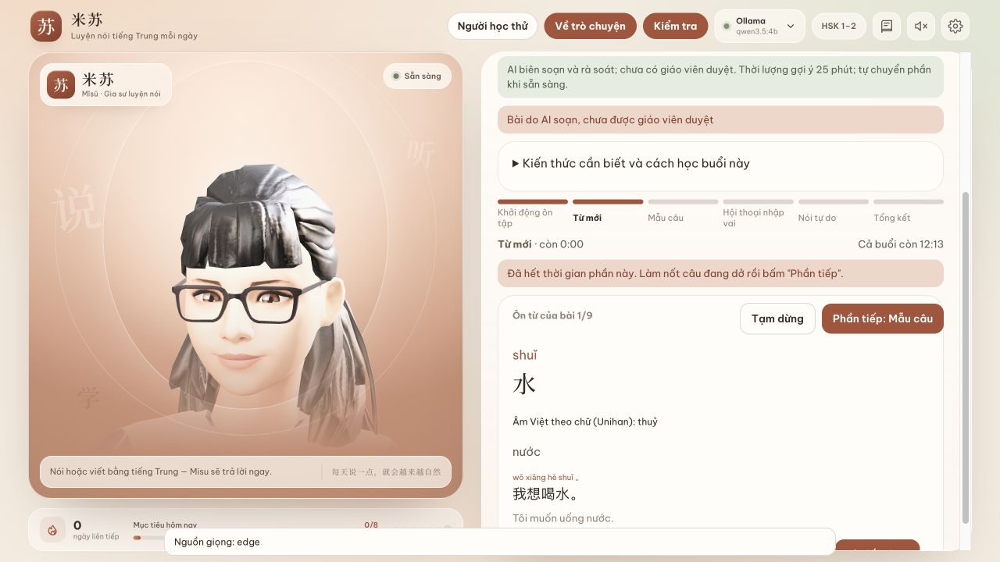

# 米苏 · Misu — luyện nghe nói tiếng Trung cho người Việt

[English](README.en.md) · [](https://github.com/hydennguyen86-code/xiaoya-chinese-tutor/actions/workflows/ci.yml)

Nói chuyện tiếng Trung với một avatar 3D, được sửa lỗi bằng tiếng Việt, chấm thanh
điệu từng chữ và luyện tai mỗi ngày. **Miễn phí, mã nguồn mở, chạy ngay trên máy
của bạn**: giọng nói và dữ liệu học không cần gửi lên dịch vụ nào.



▶ **Xem video nét hơn (50 giây):** [docs/media/demo.mp4](docs/media/demo.mp4)

*Quay từ app thật, avatar 3D mẫu, người học thử trong dữ liệu tạm. Giọng mẫu do
máy đọc. Nội dung bài học do AI soạn, chưa được giáo viên duyệt.*

*Private Chinese listening and speaking practice for Vietnamese learners: talk to
a 3D avatar, get corrections in Vietnamese, per-syllable tone feedback and daily
listening drills, all running on your own computer.*

## Điểm đặc biệt

| | |
|---|---|
| 🗣️ **Nói chuyện với avatar** | Gõ hoặc nói tiếng Trung, avatar trả lời bằng giọng nói, cử động môi theo từng câu, kèm bản dịch tiếng Việt. Câu dài trình độ HSK 5, câu ngắn chậm cho người mới. |
| ✍️ **Sửa đúng lỗi người Việt hay mắc** | Luật riêng cho các lỗi kiểu dịch từ tiếng Việt: 我工作在银行 → 在银行工作, 三个书 → 三本书, 比我很高 → 比我高… giải thích bằng tiếng Việt, cộng thêm góp ý của model. |
| 🎯 **Chấm thanh điệu từng chữ** | Đọc theo một từ, Misu tô xanh/đỏ từng chữ, bảo bạn nghe như thanh mấy và cách sửa; câu dài thì vẽ đường cao độ của bạn cạnh giọng mẫu. Chạy hoàn toàn trên máy. |
| 👂 **Luyện tai cho người Việt** | Chọn thanh nghe được, cặp âm hay lẫn (zh/z, ch/c, ü/u, an/ang, en/eng…), nghe chép, nói đuổi (shadowing), 3 tốc độ 0.7×/0.85×/1×. Câu sau ưu tiên đúng cặp bạn hay nhầm. |
| 🈶 **Âm Hán Việt và bẫy nghĩa** | Mỗi từ có âm Hán Việt (家 = gia, 学生 = học sinh) để người Việt nhớ nhanh; cảnh báo từ "nhìn quen mà nghĩa khác" (骄傲 là *tự hào*, không phải *kiêu ngạo*). |
| 📅 **Bài hôm nay, khỏi phải chọn** | Lộ trình có sẵn: HSK 1, HSK 5 (48 buổi) và 30 bài giao tiếp HSK1–6. Mỗi buổi: ôn → từ mới → mẫu câu → nhập vai (nghe trước, bấm mới hiện chữ) → nói tự do → tổng kết. |
| 📝 **Kiểm tra tuần / tháng** | Đề lấy từ chính từ và lỗi của bạn, chấm từng phần, câu sai tự vào lịch ôn. Có nhiệm vụ giao tiếp ghi rõ bạn tự làm được hay cần gợi ý. |
| 👨‍👩‍👧 **Cả nhà cùng học** | Nhiều người học trên một máy, mỗi người có trình độ, lịch sử, lịch ôn và hồ sơ giọng riêng. Dùng điện thoại làm micro qua Wi-Fi (HTTPS + mã PIN). |
| 🔒 **Riêng tư** | Model (Ollama/LM Studio), nhận dạng giọng (whisper.cpp) và chấm thanh đều chạy trên máy; dữ liệu nằm trong thư mục `data/`. Giọng đọc Edge và API tuỳ chọn mới cần mạng. |

**Nói thật về giới hạn:** chấm thanh điệu mới được đo trên giọng máy và **một**
người học thật (đúng khoảng 80% số chữ chấm được, chữ không chắc thì báo "chưa
chấm được"); bài học do AI soạn, chưa có giáo viên duyệt; âm Hán Việt lấy từ Unicode
Unihan nên còn thiếu hoặc sai một số chữ. Số đo chi tiết ở phần [Độ chính xác](#độ-chính-xác-đo-được-bao-nhiêu).

## Bắt đầu nhanh

Cần [Node.js 24](https://nodejs.org) và [Ollama](https://ollama.com) (để trò chuyện; bài học cố định chạy được cả khi chưa có).

```bash
git clone https://github.com/hydennguyen86-code/xiaoya-chinese-tutor.git
```

```bash
cd xiaoya-chinese-tutor && npm ci && ollama pull qwen3.5:4b
```

```bash
npm run build && npm start
```

Mở **http://127.0.0.1:8787**. Lần đầu, app có màn hình kiểm tra model, micro và
giọng đọc. Muốn chấm thanh điệu và nhận dạng giọng nói ngay trên máy thì chạy thêm
`npm run setup:whisper` (Mac/Linux) hoặc `npm run setup:whisper:windows`, và cài ffmpeg.
Trên Windows/Mac có thể bấm đúp `start-windows.bat` / `start-mac.command`.
Chi tiết ở phần [Cài đặt](#cài-đặt).

## Đổi avatar (khuôn mặt của Misu)

Misu có 2 kiểu avatar và bạn có thể thay bằng bất kỳ khuôn mặt nào:



**Cách nhanh nhất, ngay trong app:** bấm ⚙️ **Cài đặt** → mục **Khuôn mặt của Misu**
→ **Chọn file…** → chọn file `.glb` hoặc `.zip`. Misu đổi gương mặt ngay; bấm
**Dùng mặc định** để quay lại. File chỉ lưu trong trình duyệt đó.

**1. Avatar 3D hoạt hình (`.glb`)**, nhẹ, chạy mọi máy:
- Tạo nhân vật trên [Ready Player Me](https://readyplayer.me) hoặc [PlayerZero](https://playerzero.me).
- Tải file GLB **có kèm biểu cảm khuôn mặt** để miệng cử động được. Với Ready Player Me,
  thêm vào cuối link tải:
  `?morphTargets=ARKit,Oculus+Visemes,mouthOpen,mouthSmile,eyesClosed,eyesLookUp,eyesLookDown&textureSizeLimit=1024&textureFormat=png`
- Chọn file đó trong Cài đặt như trên.

**2. Avatar giống người thật từ một bức ảnh (`.zip`, LAM)**:
- Dựng bằng [LAM](https://github.com/aigc3d/LAM) (có bản demo online; tự chạy thì cần máy có GPU),
  tải về file `.zip` của avatar.
- Chọn file `.zip` trong Cài đặt, hoặc bật công tắc **Avatar ảnh thật (LAM)** để dùng avatar ảnh thật mẫu.
- Chỉ dùng ảnh của người đã đồng ý.

**Muốn mọi trình duyệt trên máy đều dùng avatar riêng:** đặt file vào thư mục dữ liệu,
`data/avatars/personal.glb` (3D) hoặc `data/avatars/personal-lam.zip` (ảnh thật), rồi
khởi động lại app. Thư mục `data/` không bao giờ được đưa lên Git; khi quay demo hay chụp
màn hình, chạy với `XIAOYA_SAMPLE_AVATARS=1` để chỉ dùng avatar mẫu.

**Đổi giọng đọc:** Cài đặt → **Giọng của Misu** để chọn giọng tiếng Trung và giọng đọc
bản dịch tiếng Việt. Có thể dùng giọng clone của riêng bạn qua một dịch vụ tự chạy, xem
[docs/voice-clone.md](docs/voice-clone.md).

## Học ngay: HSK 1 và HSK 5 ứng dụng

Có sẵn **48 buổi cố định**, 12 chủ đề × 2 buổi cho mỗi lộ trình, kèm **4 bài
kiểm tra chặng** tự soạn. Mở **Bài hôm nay → Lộ trình học**, chọn HSK 1 hoặc
HSK 5. Trong phần Hội thoại nhập vai có bài nghe, chọn đáp án rồi mở bản chép
lời/giải thích; tiếp theo là nhắc lại/kể lại, đọc và trả lời theo nhiệm vụ.
Nội dung cố định không cần model soạn lại; nhập vai tương tác vẫn cần model.

Có thêm **30 bài giao tiếp HSK1–6** (3 tập, bài 1–30) trong bộ chọn lộ trình,
với từ/mẫu câu, nghe nhận nghĩa và nhiệm vụ nói. Đây là lộ trình bổ sung AI
soạn, chưa duyệt; giữ mặc định HSK1/HSK5 hiện tại.

- [Tài liệu HSK 1 thực tế](lessons/courses/HSK1-GUIDE.md): khoảng 25 phút/buổi.
- [Tài liệu HSK 5 thực tế](lessons/courses/HSK5-GUIDE.md): khoảng 30 phút/buổi.
- [Nguồn dạng thi và giới hạn](lessons/courses/EXAM-ALIGNMENT.md).

Đây là giai đoạn thực hành đầu tiên, AI biên soạn và rà soát, **chưa có giáo viên
duyệt**. Không tuyên bố bao phủ toàn bộ HSK hoặc quy đổi điểm mini thành điểm
thi. Phần nói HSK 1 là mở rộng giao tiếp, không gọi là phần thi nói chính thức.

## Kiểm tra và chuẩn bị

Lần mở đầu có màn hình kiểm tra model, ghi thử micro, nhận dạng local, nghe TTS
và hội thoại mẫu. Mở lại từ **Cài đặt → Kiểm tra hệ thống và micro**.

Nút **Kiểm tra** cạnh **Bài hôm nay** cho phép thi tuần/tháng và xem lịch sử.
Bài tuần đến hạn sau 7 ngày hoặc 3 buổi mới; bài tháng sau 30 ngày. Đề lấy từ
các từ, lỗi và bài đã học của từng người. Thiếu dữ liệu thì đề ngắn hơn.
Nhiệm vụ giao tiếp dùng bối cảnh mới; xin gợi ý được ghi riêng. Điểm AI và
thanh điệu chỉ là ước lượng, không phải chứng chỉ HSK. Phần không chấm được
không tính điểm; các lần có đề khác nhau không hoàn toàn tương đương.

## Tính năng nghe nói

- **Luyện tai thanh điệu**: nghe âm/từ đôi rồi chọn thanh; ưu tiên các cặp bạn
  hay nhầm trong nghe và nói. Đối chiếu biến điệu theo `acceptTones` của học liệu.
- **Cặp âm dễ lẫn**: zh/z, ch/c, sh/s, j/q/x, ü/u và các vần n/ng;
  chọn theo tai nghe, không cần STT để chấm lựa chọn.
- **Nghe chép**: chữ Hán hoặc pinyin, nghe lại từng cụm và tô chỗ khác bản chép.
  Có nguồn Nghe của bài (198 câu/48 buổi), Bộ DeepSeek và Ví dụ của buổi học.
- **Misu chấm sai?**: gắn nhãn thanh từng chữ, ghi ai gắn nhãn và lưu bản thu
  vào dữ liệu riêng; xem số mẫu từng hồ sơ trong Cài đặt.
- **Ba tốc độ 0.7/0.85/1×**, nút nghe chậm; nhập vai mặc định ẩn chữ,
  nghe trước rồi mở lời và nghĩa.
- **Common Voice tùy chọn**: 154 câu Beijing Chinese theo danh sách AI chọn,
  có bậc ước lượng/nghĩa Việt; đọc audio tại chỗ từ nguồn người dùng tải,
  không kèm audio trong repo và không chia sẻ cho máy LAN.
- **Shadowing**: phát mẫu rồi thu nói theo, xem hai đường cao độ,
  độ dài và khoảng ngắt. Không coi đường giống nhau là chứng nhận phát âm đúng.
- **Sửa phát âm và ôn theo lịch**: chữ → từ → câu, hai lần khớp rõ liên tiếp;
  chữ chưa chấm được không tính. Câu dài hiện chưa tự xác nhận qua vòng.
  Lỗi thanh/cặp âm có lịch ôn riêng ngắn hơn từ vựng.
- **Xem câu vừa nói**: giữ tối đa 5 bản ghi, tổng 20 MB trong RAM của phiên,
  bấm xem phát âm trên transcript Whisper; tải lại trang sẽ mất bản ghi này.
- **Trôi chảy và độ trễ tham khảo**: xu hướng theo tuần, âm tiết/giây ước lượng,
  khoảng ngắt; tách thời gian STT/model/TTS/phát tiếng. Chưa xác nhận mục tiêu 2,5 giây.
- **Hán Việt và bẫy nghĩa**: tra âm Việt theo chữ từ Unihan `kVietnamese`,
  ghi rõ nguồn/biến thể/thiếu dữ liệu; không mặc định đó là âm Hán Việt chuẩn
  theo ngữ cảnh. Ghi chú DeepSeek chia **Bẫy nghĩa / Mẹo âm**, AI soạn, chưa duyệt.
- **Hội thoại và sửa câu** với model cục bộ hoặc API tùy chọn, avatar mẫu
  TalkingHead/LAM; nhiều hồ sơ học và dữ liệu lưu/sao lưu trên máy.



Các bộ DeepSeek giữ nhãn **AI soạn, chưa duyệt**. Đây là bài thực hành,
không phải đề HSK chính thức hay bằng chứng hiệu quả học trên người thật.

## Đối chiếu trước khi chọn app

Bảng này nêu tiêu chí nên kiểm tra, không khẳng định tính năng của mọi sản phẩm
trong từng nhóm và không dùng số liệu đối thủ chưa được kiểm chứng.

| Nhóm ứng dụng | Tiêu chí nên đối chiếu | Misu hiện tại / hạn chế |
|---|---|---|
| App khóa học | Chất lượng biên tập, lộ trình và trải nghiệm di động | 48 buổi thực hành HSK1/HSK5; chưa có giáo viên duyệt, chưa có app điện thoại native |
| Gia sư AI trên mạng | Sự thuận tiện, chất lượng phản hồi và dữ liệu gửi đi | Chạy model trên máy hoặc tự chọn API; cần cài đặt, model nhỏ vẫn có thể sửa sai |
| App chuyên phát âm | Phản hồi âm vị, độ tin cậy trên giọng người học | Từ 1–2 chữ có chấm thanh ước lượng; câu dài chủ yếu xem cao độ, chưa kiểm chứng với người Việt thật |
| Từ điển / app ôn từ | Độ phủ từ, chọn âm theo ngữ cảnh và lịch ôn | Có ôn từ/lỗi riêng; Unihan còn thiếu chữ/đa âm, không thay từ điển Hán Việt chuyên dụng |

Misu chưa đầu tư phần viết chữ. Có nghe giọng người thật nếu tự cấu hình Common
Voice, nhưng audio không đi kèm repo; phạm vi giọng nghe vẫn hạn chế.

## Cài đặt

Cần **Node.js 24** và npm. Đã thử trên macOS Apple Silicon; đường dẫn Windows/Linux
và CI ba hệ điều hành đã được bổ sung, **chưa thử trên Windows thật**.
Bài học cố định không cần Ollama/GPU. Trò chuyện và sửa câu cần Ollama/LM Studio
hoặc API do bạn tự cấu hình trong Cài đặt. ffmpeg cần cho Whisper/chấm thanh;
`brew install ffmpeg` trên Mac, `winget install --id Gyan.FFmpeg --exact` trên Windows.
Giọng Edge cần mạng, có giọng trình duyệt dự phòng nếu máy đã cài đúng ngôn ngữ.

```bash
git clone https://github.com/hydennguyen86-code/xiaoya-chinese-tutor.git
```

```bash
cd xiaoya-chinese-tutor && npm ci
```

Nếu dùng model local đã được đo trong repo (xem số đo phía dưới):

```bash
ollama pull qwen3.5:4b
```

Máy ít RAM có thể bắt đầu bằng bài cố định hoặc dùng API tuỳ chọn. Màn hình
**Kiểm tra hệ thống** đọc RAM máy chủ để gợi ý; RAM không bảo đảm tốc độ CPU/GPU.

Sau khi tải mã nguồn, có thể bấm đúp **start-windows.bat** hoặc
**start-mac.command**. Launcher kiểm tra Node, chạy `npm ci` lần đầu/khi lockfile
đổi, build, kiểm tra Ollama và mở trình duyệt. Mặc định chỉ mở trên máy này.
Launcher cần quyền chạy file; nếu macOS chặn file tải xuống, hãy kiểm tra nguồn
và dùng lệnh terminal bên dưới, không vô hiệu hoá bảo vệ của hệ điều hành.

Nhận dạng giọng nói cục bộ (không bắt buộc; cần git, cmake; tải về khoảng 466 MB):

```bash
npm run setup:whisper
```

Windows x64 dùng PowerShell, không cần tự build C++:

```powershell
npm run setup:whisper:windows
# Nếu chưa có ffmpeg và muốn cài qua winget:
powershell -NoProfile -File scripts/setup-whisper.ps1 -InstallFfmpeg
```

Script ghim whisper.cpp **v1.7.6** (cùng commit với script Mac/Linux), kiểm tra
SHA256 ZIP/model trước khi dùng. Các file tải về nằm trong `vendor/`, `models/`
đã được Git bỏ qua. Có thể chọn `-Size base` rồi đặt `WHISPER_MODEL` như script
hướng dẫn; `WHISPER_BIN`, `FFMPEG_PATH`, `FFPROBE_PATH` nhận đường dẫn `.exe`
có khoảng trắng. Windows ARM64 và cài đặt Windows thật chưa được xác minh.
Nếu thiếu DLL Visual C++, dùng liên kết Microsoft được script in ra.

Chạy:

```bash
npm run build && npm start
```

Mở <http://127.0.0.1:8787>. Khi phát triển dùng `npm run dev` (Vite ở cổng 5173).

Không có whisper.cpp thì micro dùng nhận dạng giọng nói của trình duyệt (Chrome
gửi âm thanh lên máy chủ Google) và không chấm được thanh điệu.

### Tuỳ chỉnh

| Biến môi trường | Mặc định | Ý nghĩa |
|---|---|---|
| `PORT`, `HOST` | `8787`, `127.0.0.1` | địa chỉ server |
| `XIAOYA_DATA_DIR` | `./data` | nơi lưu dữ liệu người học |
| `XIAOYA_SAMPLE_AVATARS` | tắt | đặt `1` để chỉ dùng avatar mẫu khi thử hoặc quay demo |
| `OLLAMA_URL`, `LMSTUDIO_URL` | cổng mặc định | máy chủ mô hình |
| `WHISPER_BIN`, `WHISPER_MODEL`, `WHISPER_PORT` | `vendor/…`, `models/ggml-small.bin`, `8178` | whisper.cpp |
| `VOICE_CLONE_URL`, `VOICE_CLONE_VI_URL` | cổng `8766`, `8767` | dịch vụ giọng clone tự chạy (không bắt buộc), xem [docs/voice-clone.md](docs/voice-clone.md) |
| `FFMPEG_PATH`, `FFPROBE_PATH` | tự tìm trong thư mục cài phổ biến hoặc PATH | công cụ âm thanh |

### Avatar của riêng bạn

Xem phần [Đổi avatar](#đổi-avatar-khuôn-mặt-của-misu) ở đầu trang.

### Mục lục sách

Repo **không** chứa nội dung sách. Để lịch học đi theo đúng bài của
《体验汉语口语》, tự gõ mục lục (tên bài, số trang, chủ đề) vào
`data/syllabus/tiyan-hanyu-kouyu.json` theo mẫu [docs/syllabus.example.json](docs/syllabus.example.json).
Chưa có file này thì Misu dùng hai lộ trình HSK 1/HSK 5 cố định trong
`lessons/courses/`. Với mục lục riêng không có bài cố định, model cục bộ tự
soạn nội dung. App không thay đổi mục lục riêng đã có.

## Độ chính xác: đo được bao nhiêu

Các bộ đo nằm trong `eval/` và chạy lại được trên máy bạn. Kết quả thô được lưu ở [eval/results/](eval/results/).
Số sửa câu đối chiếu được trong [kết quả qwen3.5:4b](eval/results/corrections-qwen3.5_4b-2026-10-24.json).
[Đo sinh bài ba trình độ](eval/results/lessons-qwen3.5_4b-2026-10-24.json) chỉ xác nhận phản hồi và cấu trúc, không chứng nhận nội dung.

**Mốc pipeline sửa câu cũ, ngày 24/10/2026** (`npm run eval:corrections`, qwen3.5:4b, bộ cũ 40 câu): 0/22 câu đúng bị
sửa nhầm; 17/18 câu sai được phát hiện, 16/18 sửa đúng như đáp án. Bộ câu nhỏ và
gồm đúng những loại lỗi mà luật đã viết cho, nên với lỗi khác (chọn từ, ngữ
pháp hiếm) phần sửa vẫn do mô hình 4B quyết định và có lúc sai. Mô hình khác cần được đo riêng bằng cùng bộ thử.

**Luật cố định — chưa bao gồm LLM**: audit nghiêm ngặt hiện có 0/112 câu đúng
bị sửa, 8/102 câu sai khớp đáp án toàn câu và 26 trường hợp chỉ khớp đoạn.
`fixed` không còn tính bằng chuỗi con; nhiều đáp án cũ chỉ là đoạn nên số này
không so trực tiếp với mốc 29/98 trước đó.
[Audit và hash nguồn](eval/results/grammar-rules-deepseek-merged-2026-10-25T14-10-55-134Z.json).
Chạy lại bằng `node eval/rule-corrections.mjs`. Nhãn thử AI chưa được chuyên gia
duyệt, không bảo đảm 0 sửa nhầm ngoài bộ thử. **Chưa đo lại pipeline LLM trên bộ mới**.

**Giọng người — nhãn tự khai peer**: lần đo tại chỗ có 55/56 mục, 6 câu riêng
học dải giọng; 45/70 âm khớp nhãn, 14 âm máy chưa rõ. Đây là một bộ thu nhỏ,
nhãn chưa được chuyên gia xác minh. Mục cắt hỏng cần thu lại; **không chỉnh ngưỡng**
vì chưa đủ 56 mục. [Kết quả tổng hợp](eval/results/tones-human-unchanged-separate_sentence_clips_same_person-human_self_peer_expert-2026-10-25T14-31-25-942Z.json).
Không chứa audio, tên người hay đường dẫn máy.

**Thanh điệu trên TTS**: bản ghi có thể đối chiếu là
[Tingting ngày 24/10/2026](eval/results/tones-macOS_Tingting-2026-10-24.json),
commit `841d68b`, working tree lúc đo còn thay đổi. Giọng tổng hợp macOS,
ngưỡng từng được chỉnh trên chính giọng Tingting nên không phải kiểm định độc lập.

| Giọng có file kết quả | Chữ đọc riêng | Chữ trong từ hai chữ |
|---|---|---|
| Tingting | 35/40 đúng, 0 chưa chấm | 25/29 chữ chấm được đúng; 3/32 chưa chấm |

Các số của Flo/Reed/Grandpa/Shelley từng ghi ở đây không có file kết quả
kèm theo trong repo, nên đã bỏ khỏi bảng có thể kiểm chứng. Chưa chạy lại bộ
TTS sau thay đổi giao diện/mốc âm tiết; ngưỡng `classifyIsolated` giữ nguyên.

Đây là giọng máy đọc chuẩn, chưa phải người học thật: độ chính xác trên giọng người
(nhất là người mới học, đọc ngập ngừng) hiện chưa được đo. Vì thế Misu chỉ chấm đúng/sai
từng chữ khi đọc từ 1–2 chữ, còn với câu dài thì chỉ vẽ đường cao độ để bạn tự
so, và báo "chưa chấm được" thay vì đoán khi không rõ. Thanh 1 và thanh 3 đọc
riêng chỉ khác nhau ở độ cao, nên Misu cần nghe bạn nói vài câu trước để biết
giọng bạn cao thấp thế nào.

## Quyền riêng tư

- Với Ollama/LM Studio, câu trả lời và sửa lỗi chạy trên máy. Whisper và chấm thanh
  chạy trên máy. Mặc định server chỉ nghe ở `127.0.0.1`; LAN là chế độ bật riêng.
- Với API tuỳ chọn, bản chép lời, hội thoại và dữ liệu học liên quan gửi tới URL
  bạn đã đồng ý. API model không nhận audio gốc; dịch vụ có thể tính phí.
- **Giọng đọc Edge** (mặc định) gửi *chữ* của câu trả lời lên dịch vụ của
  Microsoft để đọc. Khi lỗi, Mac thử `say`, rồi dùng `speechSynthesis` của trình
  duyệt trên các hệ điều hành nếu có giọng đúng ngôn ngữ. Một số giọng trình duyệt
  dùng mạng; app hiển thị nguồn giọng, không hứa tất cả đều offline.
- **Nhận dạng giọng nói của trình duyệt** (chỉ khi không có whisper.cpp) gửi âm
  thanh lên nhà cung cấp trình duyệt.
- Dữ liệu người học nằm trong `data/` (đã có trong `.gitignore`).

## Phát triển

```bash
npm run typecheck && npm test
```

- `src/`: React + Vite (giao diện, avatar, bài học).
- `server/`: Express (mô hình, giọng đọc, nhận dạng giọng nói, chấm thanh điệu,
  lưu dữ liệu).
- `eval/`: bộ đo sửa câu và thanh điệu.

## Giấy phép

Mã gốc của app: MIT ([LICENSE](LICENSE)); riêng module chuyển đổi GEC v2
`server/edgeGec.mjs` dùng LGPLv3 và được giữ dưới dạng source riêng có thể thay thế.
Avatar mẫu và các thư viện có giấy phép
riêng, trong đó avatar `brunette.glb` chỉ dùng phi thương mại. Xem
[NOTICE.md](NOTICE.md).

## Đóng góp

Xem [CONTRIBUTING.md](CONTRIBUTING.md). Bài AI soạn chưa duyệt ở [lessons/](lessons/).

### Thu bộ đo giọng thật

Trong **Kiểm tra → Ghi bộ đo giọng cá nhân**, đọc 40 chữ và 16 từ, nghe lại,
điền tên người gắn nhãn và chọn tự đánh giá hoặc người giỏi nghe. Có thể gắn
thanh thực sự nghe được cho từng chữ; `0` nghĩa là không rõ. Ghi lại sẽ xoá
nhãn cũ của mục đó để tránh dùng nhãn cho nhầm audio. Bản ghi ở
`$XIAOYA_DATA_DIR/eval-recordings/<learner>/`, mặc định dưới `data/` đã được Git bỏ qua.

```sh
npm run eval:tones -- --recordings=data/eval-recordings/<learner>
```

Lệnh chạy trực tiếp trên máy, cần ffmpeg; không cần Ollama hay mạng.
`eval/results/` chỉ nhận số tổng hợp, không có audio, tên người gắn nhãn hoặc
đường dẫn hồ sơ. Ma trận so với nhãn người nghe, tách tự đánh giá/người nghe
khác; khoảng giọng được lấy từ cùng bộ ghi nên chưa phải kiểm định độc lập.
**Chưa có bộ giọng thật được gắn nhãn. Chưa chỉnh ngưỡng thanh điệu.**
Không có số trước/sau mới để báo cáo; các số TTS bên trên vẫn là mốc tham khảo.

### Kiểm tra bản cài sạch và máy macOS khác

```sh
bash scripts/smoke-test.sh
# Bắt buộc tạo được giọng đọc, nếu máy có đủ TTS:
SMOKE_REQUIRE_TTS=1 bash scripts/smoke-test.sh
```

Script clone bản **đã commit** vào thư mục tạm, `npm ci`, build, chạy bằng avatar
mẫu và dữ liệu tạm, kiểm tra status, mục lục, hai avatar và TTS rồi dọn sạch.
Mặc định dùng cổng 8791; dừng server thử cũ trước, hoặc đặt `SMOKE_PORT`.
Linux CI không cần Ollama. Nếu TTS không khả dụng, lượt thường xác nhận
phản hồi lỗi và báo rõ chưa xác minh tạo audio; lượt `SMOKE_REQUIRE_TTS=1` thất bại.

**Chưa thử trên máy macOS thứ hai.** Khi bạn có máy khác: cài Node 24 và Git,
clone repo, chạy script trên; sau đó `npm ci`, `npm run build`, chạy
`XIAOYA_SAMPLE_AVATARS=1 XIAOYA_DATA_DIR=/tmp/misu-test npm start`.
Mở app, tạo người học thử, vào HSK 1/HSK 5 và kiểm tra nghe; cài Whisper nếu
muốn thử thu âm/chấm thanh. Ghi lại phiên bản macOS, Node, CPU, lệnh chạy,
kết quả và lỗi vào `docs/IMPLEMENTED-next-2.md`. Đây là hướng dẫn cần thử,
không phải biên bản đã thử thành công.

- Thiếu **ffmpeg**: cài `brew install ffmpeg`, hoặc đặt `FFMPEG_PATH` và `FFPROBE_PATH` tới binary thật.
- Thiếu **cmake** khi cài Whisper: `brew install cmake`, rồi chạy lại `npm run setup:whisper`.
- **Ollama chưa chạy**: mở Ollama, tải model và kiểm tra `ollama list`; bài tự soạn vẫn mở được khi chưa có model.
- **Micro bị chặn**: cho phép micro trong quyền của trình duyệt và macOS; dùng localhost, kiểm tra thiết bị đầu vào. Không đổi ngưỡng để che lỗi thu âm.

### Giọng đọc và phép thử Edge thật

Phần tương thích GEC v2 thay URL/token v1 của `msedge-tts` 2.1.0 theo
[upstream Edge TTS](https://github.com/rany2/edge-tts/issues/490). Phép thử này
chỉ đọc câu tự soạn, đòi kết quả `provider=edge`, không nhận giọng Mac thay thế:

```sh
npm run test:edge:live
```

Lệnh có mạng, được tách khỏi `npm test`/CI. Khi dùng giọng trình duyệt,
[giọng có sẵn tuỳ thiết bị](https://developer.mozilla.org/en-US/docs/Web/API/SpeechSynthesis/getVoices):
thêm gói giọng Trung `zh-CN` (hoặc Việt `vi-VN`) trong hệ điều hành rồi mở lại
trình duyệt. App không lấy giọng Anh thay cho Trung. Nếu tự đọc bị trình duyệt
chặn, bấm **Nghe** để thử lại. Giọng dự phòng không có audio để khớp khẩu hình
hoặc tạo đoạn mẫu chấm cao độ trên server.

### API cho máy yếu

Trong **Cài đặt → Máy yếu · dùng API của bạn**, nhập URL cổng Chat Completions
(gồm `/v1` hoặc đường dẫn tương ứng), mã model và key. Cổng cần hỗ trợ JSON-object
response. Chọn ô đồng ý gửi dữ liệu rồi bấm lưu; đổi URL sẽ yêu cầu đồng ý lại.
Phản hồi API được đọc trọn trước khi hiện, không bảo đảm có token xuất hiện ngay.
Chưa có model API bên ngoài nào được đo trong repo hoặc được khuyến nghị về chất lượng.

Key nằm trong `$XIAOYA_DATA_DIR/private/provider.json`, không thuộc dữ liệu
`xiaoya.*` đồng bộ trình duyệt. API cấu hình không trả key, lỗi upstream không
được phản chiếu nguyên văn. Cấu hình/xoá key chỉ thực hiện từ localhost của máy
chủ; thiết bị LAN có PIN không có quyền cấu hình. File key dựa vào quyền truy cập
hệ điều hành, không được mã hoá thành một kho bí mật riêng. Không đưa thư mục dữ
liệu vào Git. Xoá bằng nút **Xoá API/key**.

Muốn đo model bạn đã cấu hình, lệnh sau có thể tính phí theo dịch vụ. Chỉ ghi
số đo có file kết quả thực tế vào README:

```sh
EVAL_PROVIDER=compatible npm run eval:corrections -- MODEL_ID_DA_CAU_HINH http://127.0.0.1:8791
```

### Điện thoại cùng Wi-Fi: HTTPS + PIN

Mặc định vẫn là localhost. Chỉ khi muốn chia sẻ cho thiết bị tin cậy, khởi động
chế độ LAN. Thiết bị có PIN được đọc/sửa toàn bộ dữ liệu học dùng chung; đây
không phải hệ thống tài khoản tách biệt cho từng người.

macOS/Linux, với dữ liệu thử và avatar mẫu:

```sh
HOST=0.0.0.0 PORT=8791 XIAOYA_DATA_DIR=/tmp/misu-lan-test XIAOYA_SAMPLE_AVATARS=1 npm start
```

Windows PowerShell:

```powershell
$env:HOST = '0.0.0.0'
$env:PORT = '8791'
$env:XIAOYA_DATA_DIR = Join-Path $env:TEMP 'misu-lan-test'
$env:XIAOYA_SAMPLE_AVATARS = '1'
npm start
```

- Server dùng HTTPS tự ký; chứng chỉ và private key ở thư mục dữ liệu `private/`.
  Mở `https://localhost:8791` trên máy chủ sau khi thiết lập tin cậy đúng cách.
  Chỉ chuyển **chứng chỉ công khai**, không chuyển `lan-key.pem` sang điện thoại.
- Trong Cài đặt có địa chỉ IP, QR **không chứa PIN**, PIN và dấu vân tay chứng chỉ.
  Đối chiếu dấu vân tay trên máy chủ; thiết lập tin cậy bằng cài đặt chứng chỉ
  của thiết bị hoặc dùng chứng chỉ đã được tin cậy cho IP đó. Không tắt kiểm tra
  TLS hay chỉ dựa vào thao tác bỏ qua cảnh báo của trình duyệt.
- Nếu nền tảng không tin cậy chứng chỉ tự ký này cho micro/PWA, cung cấp cả
  `XIAOYA_TLS_CERT` và `XIAOYA_TLS_KEY` là đường dẫn chứng chỉ/key đã chuẩn bị,
  còn hạn và có IP Wi-Fi trong SAN. Chứng chỉ không được coi là tin cậy tự động
  chỉ vì có HTTPS. [Micro cần secure context](https://developer.mozilla.org/en-US/docs/Web/API/MediaDevices/getUserMedia).
- Điện thoại cùng Wi-Fi quét QR, nhập PIN. Session dùng cookie Secure/HttpOnly,
  tối đa 12 giờ; khởi động lại server thu hồi session. Sai 8 lần khoá 10 phút.
  Có thể đặt `XIAOYA_LAN_PIN` 6–10 chữ số; mặc định tạo mới mỗi lần chạy.
- Chỉ cho app qua firewall trên mạng riêng, không mở port router ra Internet.
  Khi IP thay đổi, kiểm tra lại địa chỉ/chứng chỉ. Dừng server để tắt chia sẻ.
- Có manifest PWA, có thể dùng “Thêm vào màn hình chính” nếu trình duyệt đáp ứng
  [điều kiện cài đặt](https://developer.mozilla.org/en-US/docs/Web/Progressive_web_apps/Guides/Making_PWAs_installable).
  Service worker không cache API/audio/dữ liệu người học; app vẫn cần server.

Đã kiểm tra UI ở 375px và luồng HTTPS/PIN bằng client thử; **chưa xác minh micro,
trust chứng chỉ hay cài PWA trên Android/iPhone thật**. Không coi kiểm tra giả lập
là kiểm tra thiết bị thật.

### Avatar riêng và bản build an toàn

Avatar riêng nằm trong `$XIAOYA_DATA_DIR/avatars/` (mặc định `data/avatars/`),
được phục vụ qua `/api/avatars/` với cùng bảo vệ LAN/PIN. Khi không ở chế độ
avatar mẫu, server tự **copy** hai file cũ `public/avatars/personal.glb` và
`personal-lam.zip` sang đây nếu đích chưa tồn tại; không xoá hoặc ghi đè file
của bạn. `XIAOYA_SAMPLE_AVATARS=1` bỏ qua cả copy và phục vụ avatar riêng.

Build chỉ copy danh sách public đã cho phép; bước kiểm tra sau build từ chối
file lạ trong dist. **Không nén gửi nguyên thư mục dist cũ**: các file `mom*`
hoặc `personal*` trong `dist/avatars/` có thể là bản chép từ build trước. Bạn
cần tự xoá bản build cũ hoặc chạy lại `npm run build`; build sẽ tạo lại dist,
nhưng không xoá file gốc trong public. Không đưa data/avatars vào gói phát hành.


### Giọng cộng đồng Common Voice (tùy chọn)

App đọc MP3 trực tiếp từ thư mục tải ngoài repo do `XIAOYA_COMMON_VOICE_DIR`
cấu hình; không sao chép audio vào dữ liệu app và không phục vụ cho máy LAN.
Lập catalog câu ngắn/đời thường bằng `npm run corpus:import`; hỗ trợ cả
`validated.tsv` và bộ `train.tsv`/`dev.tsv`/`test.tsv`.
Xem [cách cấu hình và giới hạn bộ lọc](docs/COMMON-VOICE.md).

Thiết bị LAN dùng chung PIN cũng có thể gọi nhận dạng/chấm phát âm và gửi bản thu phản hồi; PIN không phân quyền riêng giữa các hồ sơ. Chỉ chia sẻ cho người tin cậy. Bản thu để phát lại giới hạn 5 lượt và 20 MB tổng trong RAM; nút lưu nhãn là thao tác riêng ghi vào thư mục dữ liệu.

Bộ nhãn giọng thật không tự hết hạn. Trong **Cài đặt → Bộ đo người thật**, bạn
có thể xuất ZIP (chứa audio và tên người nghe) hoặc xác nhận xoá bộ thu/nhãn của
hồ sơ. Để xoá thủ công: dừng app, vào thư mục dữ liệu đã cấu hình, xoá riêng
`eval-recordings/<mã hồ sơ>`; không xoá cả thư mục dữ liệu học.
